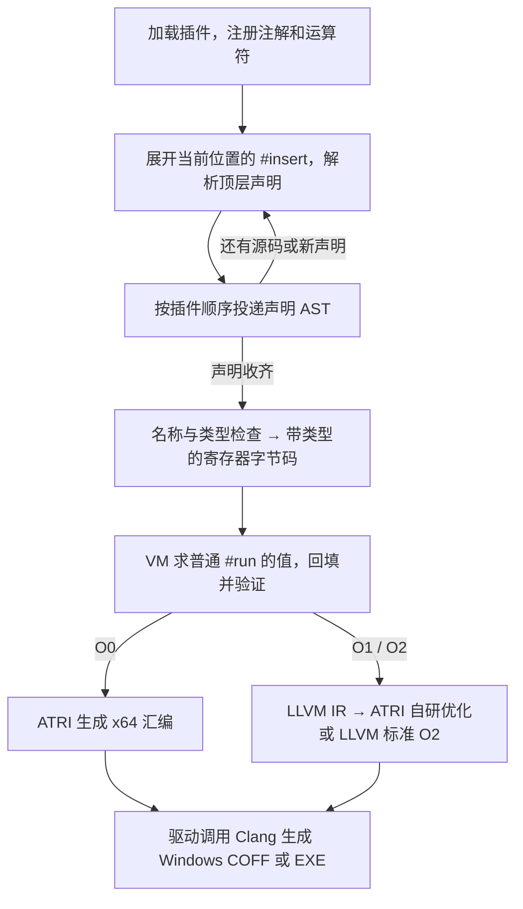

# 自研编程语言与自举编译器：架构、实现边界与语法草案

> 文档状态：设计草案 v0.1
>
> 主要目标：Windows x86-64 上完成最小、可持续自举迭代的原生编译器
>
> 初始实现语言：C23
>
> 记录范围：项目方向、编译器架构、自举路线与实现边界
>
> 语言规则：[《语言规范 v0.1》](language_spec_v0_1.md)（工作草案，未冻结）
>
> **说明**：本文为架构设计文档；语言规则统一在独立规范中维护。

## 1. 项目定位与目标

ATRI 是整体的大型个人项目，Compiler 是 ATRI 的基础子项目，也是当前建设的第一步。本文中的编译器目标与实施范围均指 Compiler；后续编译器相关文件在 `Compiler/` 内维护，由 ATRI 根 Git 仓库统一管理。

本项目的直接目标不是构建一整套完全自研的工具链，而是通过亲自实现一门强类型、命令式、以 DOP（面向数据编程）为核心取向的系统编程语言，学习和掌握语言语义、编译期执行、编译优化与原生代码生成，并将它变成后续真实项目的开发工具。

长期应用包括：

- 使用自研语言实现 RISC-V 虚拟机。
- 使用自研语言编写 Bootloader，并在虚拟机上启动自研操作系统。
- 使用自研语言实现神经网络、训练框架、推理引擎及个人 AI 系统。

这些是**长期应用方向**，不属于第一版编译器的交付范围。第一阶段专注于让编译器真正自举，并能够持续迭代。

### 第一阶段的完成定义

1. 用 C23 实现初始编译器（Stage 0），可以编译自研语言的自举子集。
2. 用自研语言编写编译器的正式实现（Stage 1 源码）。
3. Stage 0 能编译该源码得到 Stage 1；Stage 1 能再次编译同一源码得到 Stage 2；Stage 2 还能继续构建下一阶段。
4. 自举版本能够编译非玩具级的多文件程序，包括编译器自身；具有可用的错误诊断、测试和回退路径。
5. 日常迭代不再要求修改或重新实现 C23 版本，但允许继续依赖操作系统、C 库、外部汇编器和链接器。

**自举不等于完全独立工具链**：无需自研汇编器、链接器、可执行文件加载器或 C 标准库。

---

## 2. 固定决策、推荐方案与非目标

### 2.1 已明确的方向

| 项目               | 决策                                                                 |
| ------------------ | -------------------------------------------------------------------- |
| 开发及首个目标平台 | Windows x86-64                                                       |
| Stage 0            | C23                                                                  |
| 语言定位           | 强类型、命令式、偏底层，以 DOP 为核心取向的通用编程语言               |
| 语法风格           | 类 C；优先语义明确、易解析，不追求语法创新                           |
| 函数定义           | `fn add(a: i32, b: i32) -> i32 { ... }`，尾部返回类型                  |
| 数值类型           | 固定宽度 `i8/i16/i32/i64`、`u8/u16/u32/u64` 等；不使用传统泛称 `int` |
| 转换规则           | 禁止普通类型之间的隐式转换；显式 `cast(u8, rgba)`                      |
| 变量与常量声明     | `name: Type [= expr]` 可变且默认零初始化；`name: Type := expr` 必须在编译期得到结果，无 let/const 声明关键字 |
| 编译期执行         | `#run` 执行直接函数调用或代码块，`#insert #run` 执行生成器并原位展开文本 |
| 元编程             | 按编译参数顺序投递顶层声明，可注册注解与中缀运算符、改写 AST、注入新声明 |
| 声明               | 普通调用可引用后定义的函数，源码插入要求生成器已在插入点之前定义 |
| 分支               | `if/else`、传统形状的 `switch`；显式 `#through;` 贯穿                              |
| 循环               | `loop`、`while`、`for`、`do...while`                                 |
| 内置能力           | `defer`、`sizeof`、`alignof`；地址获取 `&`、解引用 `*`               |
| 数据结构           | `struct`；保留底层无标签 `union`；枚举支持携带数据的变体             |
| 结构体初始化       | `{.field = expression}` 指定字段初始化，省略字段优先采用声明默认值；完整边界见语言规范 |
| 结构体布局         | BD-16 已接受：声明顺序与自然对齐；空结构体大小 0、对齐 1，零大小对象配套边界继续审查 |
| 字符与字符串       | u8/i8 字节字符、`*u8` 零结尾字符串字面量；存储/调用与 C 兼容，解析采用语言自己的规则，内置 `string` 整体暂缓；规则见语言规范第 5.5 节 |
| 数组访问           | `arr[index]`；当前 C 兼容布局、有限静态检查，运行时越界检查后续探索，见 ARRAY-01 |
| 互操作             | 稳定 ABI 与目标 C 一致；extern(C)/puts 最小子集已实现，完整覆盖继续验收 |
| 代码产物           | 编译器输出汇编，外部汇编器与链接器负责 `.obj`、`.exe`                |
| 优化               | 实现自己的 IR 与优化器，不仅仅直接从 AST 输出汇编                    |
| 运行时成本         | 零开销设计方向；不强制隐式运行时机制，必要语义成本与默认检查策略见基础默认行为审查稿 |
| 清理与异常         | `defer` 在词法作用域退出时逆序执行，条件和实参在清理时求值。语言无异常机制 |
| 代码体边界         | if/循环体使用 `{}`。defer 接受块或直接调用。switch 的 case 以标签分界，可另开词法块 |

### 2.2 当前推荐的最小工程选择（尚可调整）

- 第一版仅维护**一种有类型、带基本块和显式控制流的通用 IR**，不强制立即实现 SSA 或第二级 Machine IR。
- 编译期程序先由**解释器**执行，避免依赖目标机器码运行。
- `import` 采用模块语义。导入形式、单次加载、重名诊断和定义模块名称解析统一见[语言规范第 11 节](language_spec_v0_1.md#11-模块与名称空间)。当前已实现相对 .ar 导入、函数及标量/聚合全局导出、共享全局存储与静态初始化。
- 用户已撤回 match，采用语句式 switch；case 不强制花括号，默认不贯穿，显式 #through 进入下一分支。当前使用整数比较链和已有 CFG，不增加模式/解构或穷尽性系统。
- 普通枚举已确定为底层整数别名及命名空间内的整数常量；携带 Payload 的变体仍待独立设计；`union` 保留无标签、共享存储的低层语义，已实现的简单 C 兼容子集见[语言规范第 9.2 节](language_spec_v0_1.md#92-无标签联合体)，不据此增加自举必需范围。
- `isize`、`usize` 首版暂缓及长度类型等其余方案统一见语言规范 TYPE-03；本轮已确认并实现 Windows x86-64 上 sizeof/alignof 返回 u64 编译期值，不据此固定所有平台的大小类型。
- 第一版以手动内存管理、显式错误处理为主，不引入所有权/借用检查、强制 GC 或大型运行时。

### 2.3 明确暂不实现

- 自研汇编器、链接器、PE/COFF 写入器。
- Linux、ARM64、RISC-V 的编译后端；第一阶段先完成 Windows x86-64。
- 完整标准库、包管理器、语言服务器、IDE 插件。
- 自研 JIT、GPU 后端、自动向量化、LTO/PGO 和复杂机器相关优化。
- 复杂对象系统、异常运行时、所有权/借用检查、垃圾回收。
- 完整 PDB/CodeView 源码级调试（但必须保留源码位置和基本可调试性）。
- 多线程编译、跨次构建的增量编译系统及持久化 AST 缓存。单次构建内的增量声明投递见第 3.2 节。

未来如有真实需求可以增加；不因“其他编译器都有”而扩大范围。

---

## 3. 编译器总体架构



生成器在插入点用已完成的定义生成文本。普通调用的名称则在声明收齐后解析，因此 `main` 可以使用由后续事件生成的函数。[可执行示例与详细链路](../docs/metaprograms.md)

### 3.1 前端

- **Lexer / Parser**：只负责词法、语法与源码位置；允许未解析的标识符出现在 AST 中，语法阶段不进行完整类型检查。
- **AST**：保留源文件、行列或源码区间；提供稳定节点标识、父子关系和查询/修改接口。
- **Module Manager**：解析 `import`、管理模块缓存与模块作用域。
- **Symbol System**：先发现顶层声明，再按需解析符号；无需前向声明。
- **Type Checker**：检查表达式类型、操作合法性、调用约定和数据布局；区分语法树与已完成语义分析的结果。

### 3.2 Comptime / AST 元编程

声明监听器按注册顺序处理尚未定型的语法树，最后一个监听器交回声明后，编译器使用最终名称、类型和布局。`#insert` 在声明成形前由此前已定义的生成器产生字符。`#run` 则在语义分析后请求 VM 执行。两者共用寄存器指令、调用栈及宿主绑定。循环依赖、无效的生成文本、类型错误和求值失败均带有来源位置。[语言规则](language_spec_v0_1.md#12-编译期执行与-ast-元编程) · [实现与诊断](../docs/metaprograms.md)

### 3.3 IR 与优化器

开发时以全量构建（clean build）为基线。每次构建从源码开始，按需求值本次的 `#run` 并展开生成的源码。构建内按依赖挂起和恢复任务，可以复用已编码的函数字节码。O0 的设计目标是缩短一次全量构建的周转时间，直接从 ATRI IR 选择 x64 指令，输出汇编后交给驱动汇编和链接。

Stage 0 的带类型寄存器字节码由 VM、O0 和 LLVM IR 翻译器共用。默认 O0 由 ATRI 选取 x64 指令，驱动调用外部汇编器和链接器。O1 在 LLVM IR 上运行自研整数优化 pass，O2 运行 LLVM 标准 O2 管线，两档共用 LLVM 目标代码生成。生成可执行文件时按运行期可达性筛选函数、数据和外部调用。[编译链与成本](../docs/metaprograms.md)

IR 的作用：在完成编译期变换和必要语义分析后，把高级语言降为统一的、易于分析和面向执行的表示，解耦前端与 CPU 后端。

最小 IR 建议具备：

- 函数、参数、基本块和显式控制流：`branch`、`jump`、`return`。
- 有类型的整数/浮点运算、比较、转换。
- 内存访问：地址计算、`load`、`store`、局部对象及全局引用。
- 函数调用、返回值、外部符号引用。
- 明确的副作用规则；未来扩展 `volatile`、原子操作不能与普通访存混为一谈。

Stage 0 的 O0 已有局部折叠和死指令消除，O1 学习后端已在 LLVM IR 上实现整数常量折叠与恒等式化简。复制传播、进一步的 CFG 简化和公共子表达式消除可作为后续优化课题。IR Verifier 检查类型、基本块终结和跳转目标等约束。[当前优化算法](../docs/backend.md)

**不要求第一版就有多级 IR 或完整 SSA**。初期可以使用三地址 IR，等数据流优化需要时加入 SSA；后端也可以先使用临时机器指令结构，而不是设计第二套正式 Machine IR。

### 3.4 x86-64 后端与工具链

自研后端负责：指令选择、寄存器/栈槽分配、栈帧、函数调用、数据/符号引用及 Windows x64 ABI。外部工具负责汇编、重定位处理和链接。

```text
compiler source.my -S -o source.asm
assembler source.asm -> source.obj
linker source.obj + libraries -> source.exe
```

当前驱动封装外部汇编和链接，`-c` 生成 Windows COFF，`--exe` 生成可执行文件，`-S` 和 `--emit-ir` 可检查中间结果。自行实现汇编器与链接器留作后续独立工作。

**重要边界**：C ABI 兼容并不自动让汇编代码符合 ABI；参数与返回值位置、寄存器保存、栈对齐、shadow space、聚合类型传参/返回、可变参数和 Windows x64 栈展开元数据均需要由后端按目标规范处理。第一版可优先覆盖自举所用的 C ABI 子集，完整目标 ABI 作为后续兼容性验收。

Stage 0 的 O0 输出 Clang 集成汇编器接受的 Intel 语法和 Windows 展开元数据。`-c` 在目标文件处停止，`--exe` 继续链接程序。[工具链驱动](../src/clang_driver.c)

---

## 4. 语言规范与规则来源

语言相关内容已抽离到独立的[《语言规范 v0.1》](language_spec_v0_1.md)。该文档集中维护词法、语法、类型、求值、控制流、内存、模块、C 互操作及编译期执行的语言契约。

规范仍是工作草案，区分**已确定**、**建议**、**待定**和**示意**；本次抽离不将原有建议升级为正式决策。

- 语言使用者可见的规则，以语言规范为统一维护入口。
- 本文保留项目方向、实现建议、架构边界与自举验收。
- 本文第 2 节是项目范围摘要；若与语言规范出现不一致，应显式修订并同步两处，不隐式覆盖已有决策。
- 后续独立编写 Comptime 规范时，应迁移对应规则并建立引用，避免重复定义。
- 核心可自举子集候选见语言规范附录 A，目前尚未冻结，也未改变本文 M0 至 M5 的验收依赖。
- 用户授权先拟定基础默认行为再审查，候选规则与理由见[基础默认行为审查稿](language_defaults_review_v0_1.md)；数值、内存和运行时检查选择不得与零开销方向产生未说明的冲突。

---

## 5. 自举实施路线与验收

| 里程碑               | 核心交付                                         | 验收标准                                                    |
| -------------------- | ------------------------------------------------ | ----------------------------------------------------------- |
| M0：C23 最小闭环     | Lexer/Parser/AST、基础语义、最简 IR、x86-64 汇编 | 能生成并运行有函数、控制流、结构体、基本 C 调用的程序       |
| M1：自举所需语言子集 | 指针、数组、枚举、模块、内存与基础库接口   | 能编写多文件、使用动态数据结构的非平凡程序                  |
| M2：Comptime         | `#run`、解释器、AST 反射/构造/修改、失效机制      | 能在编译期改变声明和表达式，重新分析并生成正确程序          |
| M3：优化器与后端     | IR Verifier、基础优化、ABI 测试、稳定汇编输出    | `-O0` 与优化版本在可观察行为上符合语言语义                  |
| M4：第一次自举       | 用自研语言重写/实现编译器主体                    | Stage 0 → Stage 1 → Stage 2 → Stage 3 成功                  |
| M5：可持续迭代       | 回归测试、构建脚本、诊断、稳定版本保留           | 日常直接用自研语言修改、编译、测试编译器，无须回到 C23 开发 |

上述是**完成标准和依赖顺序**，并非必须等前一阶段完全结束才开始后一阶段；实现时允许先作纵向贯通的小闭环，再补齐语言能力。

### 自举阶段验证

```text
C23 编译器 ──构建──> Stage0.exe
Stage0.exe  ──编译自研语言的编译器源码──> Stage1.exe
Stage1.exe  ──编译同一份源码──────────> Stage2.exe
Stage2.exe  ──编译同一份源码──────────> Stage3.exe
```

至少验证：

- 各阶段可运行，并通过相同的功能与编译器回归测试。
- 编译期与运行期相同运算的语义一致。
- 优化关闭 `-O0` 时仍有一条可靠的编译路径。
- 对同一源码，在固定工具链与环境下输出可复现；必要时比较规范化 IR/汇编，而非把 PE 的字节完全相同作为唯一标准。
- 保留最后一个可用的编译器二进制和 C23 Stage 0 源码，作为回退与干净重建路径。

### 最小测试基础设施

- Lexer/Parser/AST 结构测试与错误诊断测试。
- 类型系统的正例和预期编译失败用例。
- `#run` 与 AST 修改后的重新解析/重新分析测试。
- IR Verifier、单 Pass 与组合 Pass 回归测试。
- 汇编/运行结果测试；在可行处与可信参考实现或手工预期结果比较。
- C ABI 双向互操作测试：自研语言调用 C，C 调用自研语言。
- 源码位置、AST/IR Dump、汇编输出以及最小崩溃定位能力。

---

## 6. 核心语义契约与待决策事项

语义问题与决策清单已统一迁移到[《语言规范 v0.1》](language_spec_v0_1.md)第 15 节。优先解决求值顺序、数值边界、类型转换、初始化与内存、模块和编译期调度，避免解释器、优化器与后端采用相互矛盾的规则。

建议逐步形成三份内部契约：

1. **核心语言规范**：已建立独立工作草案，首个实现子集仍待讨论和冻结。
2. **Comptime 与 AST 修改语义**：当前集中在语言规范第 12 节，调度与修改生效规则明确后可独立成文。
3. **IR 不变量**：随最小 IR 设计单独记录，属于编译器内部契约，不混入语言语法规范。

核心可自举子集的讨论不得自动取消原先的语言能力目标；若调整完整 Comptime 与首次自举的先后关系，应明确更新本文里程碑。

---

## 7. 为什么这套边界足够？

1. **它已经包含完整编译闭环。** 从源码、语义、编译期执行到 IR、优化、汇编，再由成熟工具生成可执行文件，能够运行真实程序，而不是只能解释表达式的玩具编译器。
2. **它能够自举并持续迭代。** 只要语言子集足以表达编译器所需的数据结构、算法、I/O 和元编程机制，就不必先实现整个语言的全部愿景。
3. **它覆盖了真正感兴趣的知识。** 编译原理、元编程、优化、机器指令、ABI 都需要亲自实现；链接器的重定位算法等不必成为独立项目。
4. **它有明确的长期扩展点。** 未来加 RISC-V/ARM64 后端、Freestanding 模式、SIMD 与原子操作，主要是扩展目标描述、后端或底层语义，而非推翻全部前端。
5. **它不会预支虚拟机、操作系统和 AI 的复杂度。** 这些项目可以在编译器稳定后，由真实需求推动语言增加能力，而不是在第一次自举时全部实现。
6. **它保留了学习价值与工程实用性。** 有优化前后验证、ABI 测试、自举测试和调试输出，可以判断系统是否真正正确，而不仅仅是能够输出一段汇编。

### 核心架构原则

> **可修改的 AST 负责描述和生成程序；语义分析负责定义并验证程序；通用 IR 负责表达可执行语义和承载优化；机器后端负责目标架构与 ABI；外部汇编器和链接器负责生成目标文件与可执行文件。**

在这个边界内，从 C23 编写一个小而正确的 Stage 0 开始，比预先设计复杂的全平台编译器更符合项目目标。

---

## 8. 下一步最小行动清单

当前 C23 Stage 0 已接通源码到 Windows x64 汇编的编译链路，使用 Clang 汇编与链接。已有多级数据指针、静态全局和 C 固定及可变参数调用，当前程序入口仍为 `main() -> i32`。实现范围和内部契约见[基础编译原型](parser_subset_v0_1.md)、[指针子集](pointer_subset_v0_1.md)及 [IR 设计](ir_design_v0_1.md)。完整 C ABI、聚合编译期值及 #run 块执行和 AST 元编程继续按各自里程碑验收。

1. 完善独立语言规范，逐项确定核心类型、值/内存、求值顺序和转换规则，确保编译期与运行期含义一致。
2. 冻结足够解析首批源文件的最小语法（包括函数、变量、表达式、控制流、类型、导入）。
3. 在 C23 中实现 AST、符号收集和一个能够从 Typed AST 降低的最小 IR。
4. 让一条端到端链路生成 Windows x64 汇编，使用外部汇编器和链接器运行。
5. 已接通普通编译期调用、代码块、声明监听与源码展开。通用聚合编译期物化和首次自举的验收范围仍按各自规范推进。
6. 扩展语言子集和优化器，直到可以用自研语言实现编译器自身，并完成多阶段自举。

**阶段原则：先做完整纵向链路，再逐步加强每一层；不在自举目标之外提前扩张功能。**

2026-11-16：BD-19 控制流纵向实现已完成，含 bool、比较、短路、分支/各类循环，以及编译期分支/循环/递归；当前多块函数暂不做跨块优化。详细验收和剩余边界见[进度记录](progress_v0_1.md)。
