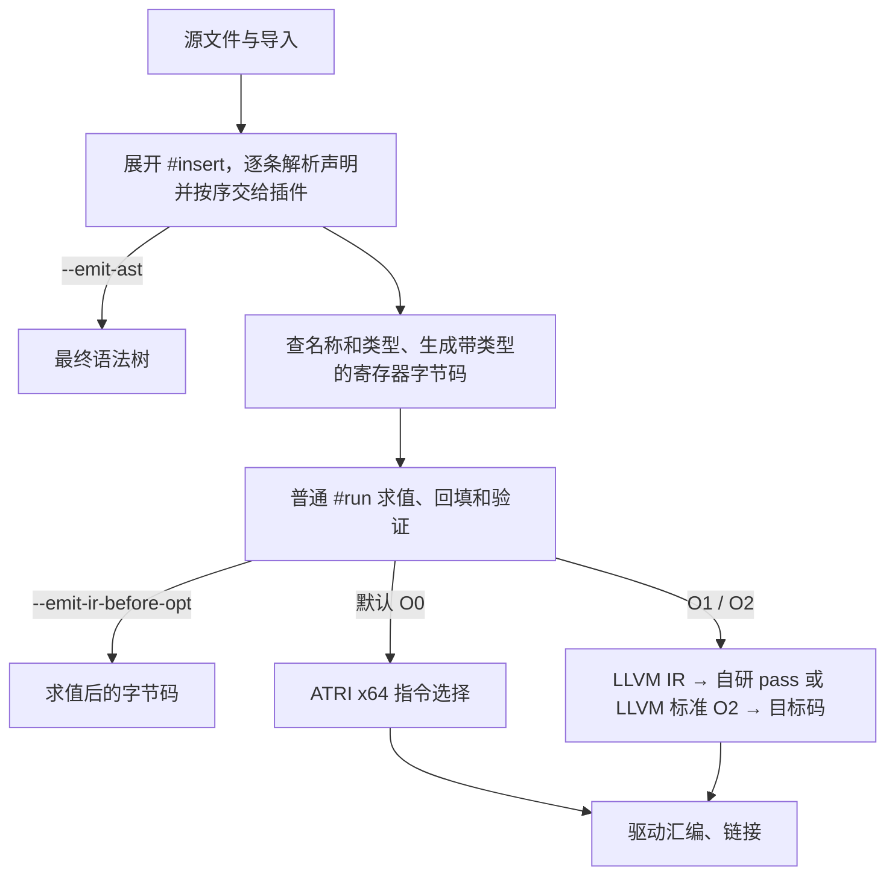

# Stage 0 编译器实现导读

ATRI 的 Stage 0 编译器用 C23 实现。从源码跟踪一个值，可以依次看它引用哪份声明、在哪个阶段求值，以及最终如何存储和传递。

| 想弄清的问题 | 实现导读 | 对应源码 |
| --- | --- | --- |
| 顶层声明何时交给插件？生成的函数怎样被 `#run` 使用？O1 与 O2 各走哪条路径？ | [声明事件、编译期 VM 与原生输出](metaprograms.md) | [调度](../src/meta.c)、[VM 字节码](../src/vm_bytecode.c)、[LLVM 后端](../src/backend_llvm.c) |
| 两个文件导入同一模块，为什么能共享全局？字段和数组占多少字节？ | [前端、模块与类型布局](frontend.md) | [加载器](../src/modules.c)、[解析器](../src/parser.c)、[布局](../src/types.c) |
| 哪些表达式在编译期执行？短路、循环和清理怎样变成跳转？ | [从语法树到可执行 IR](lowering.md) | [降低器](../src/lower.c)、[常量解释器](../src/consteval.c) |
| 如何发现无效 IR？为什么某个调用消失了？聚合如何跨越 C 调用边界？ | [IR 验证、优化与 x64 生成](backend.md) | [验证器](../src/ir_verify.c)、[优化器](../src/optimize.c)、[后端](../src/backend_x64.c) |
| 生成的代码出错，怎样找到应该修改的那行？ | [诊断位置与生成来源](diagnostics.md) | [诊断输出](../src/diagnostic.c)、[模块定位](../src/modules.c) |

## 一次编译经过哪些阶段



`atri-parse` 默认输出抽象语法树（AST），`atri-cc` 默认输出汇编。两者共用同一驱动，参数决定停在哪个阶段。AST 适合核对运算符和语句的归属，优化前 IR（中间表示）适合检查类型、常量结果和控制流，汇编可看到实际的寄存器、栈槽和调用。[驱动入口](../src/main.c)

## 跟踪同一个加法

在 `Compiler/` 完成构建后运行下面三条命令，观察各自输出中的 main 函数。两个源文件都定义了 `add`，区别在于调用出现的位置。[构建入口](../README.md#运行整数编译原型) · [constants.ar](../examples/constants.ar) · [main.ar](../examples/main.ar)

```powershell
.\build\atri-cc.exe --emit-ir-before-opt examples/constants.ar
.\build\atri-cc.exe -O0 --emit-ir examples/main.ar
.\build\atri-cc.exe -O1 --emit-ir examples/main.ar
```

| 源码中的调用位置 | 在 `main` 中看到什么 | 原因 |
| --- | --- | --- |
| `n: i32 := add(1, 2);` | 优化前已有 `const i32 3`，随后返回它 | `:=` 要求编译器执行这次调用 |
| `return add(a, b);`，`-O0` | 实参已是 1 和 2，仍有 `call i32 @add` | `a`、`b` 是编译期常量，普通调用保留 |
| 同一条 `return`，`-O1` | LLVM IR 中仍有对 add 的调用 | 普通调用交给 LLVM 目标代码生成；当前自研 pass 处理整数常量和恒等式 |

语言规则查[语言规范](../NEXT/language_spec_v0_1.md)，功能边界查[实现子集](../NEXT/parser_subset_v0_1.md)，指令约束查[IR 设计](../NEXT/ir_design_v0_1.md)。修改和验证代码时可参阅[开发约定](development.md)和[测试说明](../tests/README.md)。
