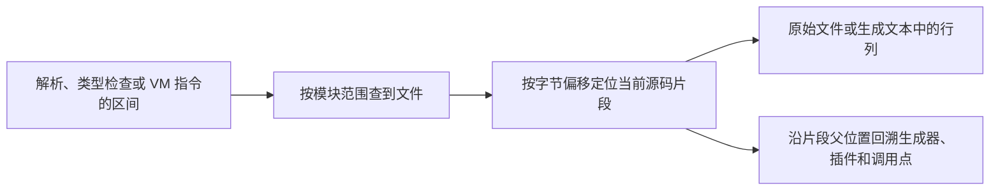

# 从一条编译错误找到源码

一条诊断包含一个主区间、错误消息和按需添加的位置说明。先读 `error` 指向的表达式，再沿 `note` 查调用者、声明或插入点。编译器用半开字节区间保存位置，显示时根据对应模块的原文计算行列和下划线。[诊断结构](../src/frontend.h) · [终端渲染](../src/diagnostic.c)

| 出错的地方 | 主位置 | 辅助位置 |
| --- | --- | --- |
| 函数实参类型不符 | 实参表达式，显示期望和实际类型 | 相应形参的类型声明 |
| 重复的模块名称 | 第二处声明 | 先前声明 |
| `#run` 求值失败 | 当前执行的字节码指令对应的表达式 | 等待中的调用和发起求值的位置 |
| `#insert` 生成的语法有误 | 对应生成片段中的字符 | 谁插入了该片段，以及上一级展开点 |
| 插件替换后仍有类型错误 | 最终 AST 所在的片段 | 产生该片段的插件与原声明 |

例如 `emit` 返回 `return 1 + ;` 时，第 12 列的分号占据了右操作数的位置。生成器可能从文件读取或拼接字符串，能准确定位的是它返回的文本与调用点。

```text
<generated by emit>:1:12: error: expected an expression
return 1 + ;
           ^
main.ar:3:5: note: expanded or rewritten here
    #insert #run emit()
    ^~~~~~~~~~~~~~~~~~~
```



每次源码替换保留原文本和新片段，记录新片段的创建位置。片段列表表示当前文件的拼接顺序，诊断跨片段时同时提示另一端的位置。VM 使用现有任务栈补全调用路径。一次诊断最多显示 12 条附加标签，超出的数量单独提示。很深的生成链显示最近六层和原始调用点。当前策略报告首个阻断该编译的错误。[片段来源](../src/source_map.c) · [跨模块定位](../src/modules.c) · [VM 调用链](../src/consteval.c)

可以在 `Compiler/` 执行 `ctest --test-dir build -R compiler-pipeline --output-on-failure`，覆盖生成文本位置、跨模块生成器失败，以及类型不匹配与对应的形参位置。[测试用例](../tests/pipeline_tests.cmake)
