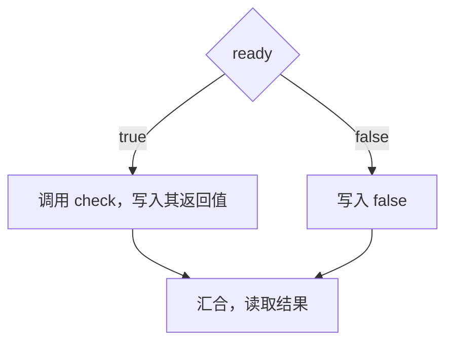

# 从语法树到可执行 IR

`atri_lower` 先准备类型布局和函数签名，再逐个检查函数体并生成 IR。因此函数可调用写在后面的定义，调用点也已知道实参和返回值应具备的类型。处理函数体时，降低器还要确定哪些数据需要存储、哪些计算必须在编译期完成。[降低器入口](../src/lower.c)

## 值、位置与指针

直线代码里，未取地址的可变标量可以直接绑定到当前值的指令 ID，赋值只需更新绑定。取过地址的变量需要稳定的存储，才能让 `x` 和 `*p` 观察到同一次写入。有分支或循环时，降低器也为可变局部保留存储，使不同路径可以更新同一对象。

以 `items[i] += f();` 为例，先算出数组元素的位置（`INDEX`），读取旧值（`LOAD`），再调用 `f`、做加法，最后向原位置 `STORE`。下标只求值一次。`FIELD` 和 `INDEX` 都能表示位置，要把该位置作为语言中的指针传给函数，则通过 `ADDRESS` 取址。指针加减按直接目标类型的大小缩放，两个同类型指针相减得到以元素为单位的 `i64` 差值。[IR 数据结构](../src/ir.h) · [指针实现边界](../NEXT/pointer_subset_v0_1.md)

## 短路、分支和清理

基本块是一段只有一个入口、末尾决定下一步去向的指令。块之间的跳转组成控制流图（CFG）。例如运行期表达式 `ready && check()` 会生成下图。两条路径把结果写入同一个临时布尔对象，汇合处只需读取该对象。

| 功能 | 降低时生成什么 | 可观察的效果 |
| --- | --- | --- |
| 循环 | 建立条件、循环体及相应回边，记录退出目标和继续目标。 | `break` 转到最近循环或 `switch` 的出口，`continue` 寻找最近循环的继续目标。 |
| `switch` | 选择值计算一次，各 `case` 的编译期结果与它依次比较。未命中转到 `default` 或出口。 | 最坏比较次数随标签数线性增长。非空分支默认跳到出口，空标签和显式 `#through;` 可转到下一分支体。 |
| `defer` | 登记延迟体和当时可见的绑定，在离开作用域的每条边上逆序展开。 | 条件和实参在轮到该条清理时求值。外层 `return` 先保存结果，再做清理。多条退出边可能各生成一份清理代码。 |

测试里的 `order()` 执行到 `return value;` 时，局部变量的值为 1。清理随后把变量改为 4，较早登记的 `record(value)` 读到 4，调用者仍收到 1。[延迟清理用例](../tests/cases/defer_cleanup.ar) · [枚举与 switch 示例](../examples/enum_switch.ar)

## 编译器怎样执行一次调用

1. **登记必须求值的表达式。** 对 `:=`、`#run` 调用和 `case`，降低器记录初始化指令区间、表达式 ID 和结果占位。后续指令可以先引用占位。
2. **直接执行寄存器字节码，按需建立跳转与常量索引。** 每个函数共享一份指令流，每次调用建立独立帧，分别记录实参、指令结果和可变局部。程序计数器沿选中的分支执行，循环再次经过同一条指令时重新计算结果。常量依赖有“求值中”和“已完成”标记，分别用于发现依赖环和复用结果。一次完整求值共享 100000 步预算，递归与依赖深度上限为 256。[VM 执行与恢复](metaprograms.md)
3. **把结果写回 IR。** 所有强制求值成功后，以常量替换占位，把原计算区间标成 `NOP`。因此 `n: i32 := add(1, 2);` 在优化前就得到 3。执行到未绑定的宿主 C 调用或超出预算会产生编译错误。[常量解释器](../src/consteval.c) · [可执行的 #run 用例](../tests/cases/run_constants.ar)

求值结果还有两类用途。对于 `switch`，降低器把同一组的 `case` 按位模式排序，相邻相等就能发现两个不同表达式算出了同一个标签。对于聚合全局，编译器先按布局分配全零字节，再把各标量叶子的结果按目标小端顺序写入字段或元素偏移。这样能生成带嵌套字段的静态数据，同时让解释器只处理支持的标量计算。[静态初始化示例](../examples/struct_globals.ar) · [IR 契约](../NEXT/ir_design_v0_1.md)
