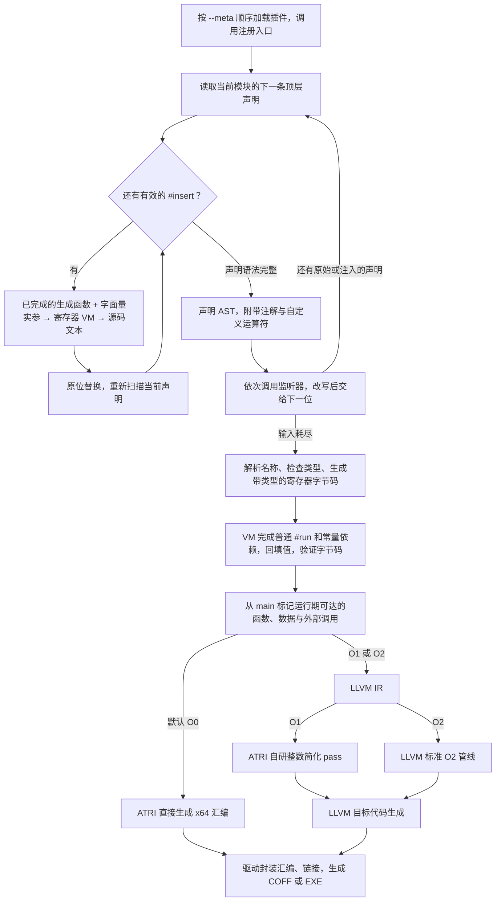

# 一条声明怎样成为可执行代码

在下面的 Windows x64 示例中，`emit(2)` 生成一段表达式，`@math` 插件把 `%%` 改成加法，`#run` 块在编译期算出循环的和。生成的程序以 `11` 退出。可以从 `Compiler/` 运行以下命令。[源程序](../examples/meta/pipeline.ar) · [运算符插件](../examples/meta/operators.ar)

```powershell
.\build\atri-cc.exe --meta examples/meta/operators.ar --exe -o build/pipeline.exe examples/meta/pipeline.ar
.\build\pipeline.exe
$LASTEXITCODE # 11
```



## 插件的两个入口

1. **编译开始时声明语法能力。** 驱动按命令行次序加载每个 `--meta`。传入 `.ar` 会先编译为临时 DLL，也可直接加载其他语言生成的兼容 DLL。可选的 `register() -> i32` 调用宿主 API 注册注解名及中缀运算符。使用宿主 AST 或注册 API 的原生插件链接对应驱动的导入库，例如 build/atri-cc.lib。注册表在解析用户源码前就绪。每个注册名在本次编译中唯一。
2. **收到声明时决定是否改写。** 固定回调 `message` 收到本次构建内的声明 ID、种类、模块、名字、当前源码和两个输出位置。每个监听器都收到每条顶层声明一次。注册了注解的插件也在此回调里处理语义。回调返回 0 继续，非零终止编译。[C ABI](../src/meta_plugin.h) · [加载器](../src/meta_host.c)

例如插件注册 `math` 和 `%%` 后，`@math fn f() -> i32 { return 2 %% 3; }` 能解析出含两个操作数的节点。没有注册的 `@name` 仍随声明保留。词法器只在当前声明启用相应符号，解析器按注册的优先级和结合性建树。若同一声明启用的两个注解给同一符号提供定义，编译器在注解处报错。进入类型检查时仍有未处理的自定义运算符，也会报错。[注册与匹配](../src/meta_syntax.c) · [表达式解析](../src/parser.c)

运算符示例用 `compiler :: import "std::compiler";` 取得宿主接口。`message` 找到 `%%` 后，`ast_to_code` 分别借用左右操作数的源码，`text::join` 将它们与括号、加号拼入一个 `list(u8)`。`code_to_ast` 在当前声明语法作用域解析新表达式。成功后原节点句柄已失效，循环从头取得新句柄。缓冲区在解析完成后由 `defer release(&code)` 释放。[完整插件](../examples/meta/operators.ar)

| 监听器要做的事 | 接口及生命周期 |
| --- | --- |
| 找声明及操作数 | `atri_ast_has_annotation` 测注解。用 `atri_ast_expression_count/expression` 枚举节点，用 `atri_ast_operator/operand` 查运算符和子节点。 |
| 取得可编辑源码 | ATRI 插件用 `compiler::ast_to_code(handle)` 取得借用 string，也可用 `#keyword(handle)` 取得 C 字符指针。C 插件用 `atri_ast_source(handle)`。编译器按当前 AST 的词法单元格式化，保留字面量和分组，略去注释及原排版。诊断单独保存原文。 |
| 修改表达式或当前声明 | `atri_ast_replace(handle, text)` 在当前语法作用域重解析。替换表达式会保留其分组。一次成功修改后重新取得表达式句柄，声明 ID 保持稳定。也可在回调的 `replacement` 返回整条声明源码。 |
| 新增顶层声明 | 在 `injection` 返回声明源码。编译器复制到当前模块末尾，新增声明从第一个监听器开始。替换当前声明后则从下一个监听器继续。 |

回调看到的是当前声明的语法结构。插件 A 可以先把一个返回 `i32` 的函数改成 `return true;`，插件 B 仍有机会改正它。编译器在所有声明处理完之后统一解析名称和检查类型。这里的增量指一次完整构建中逐条投递声明。[声明调度](../src/meta.c) · [节点接口](../src/meta_ast.c)

### 为何 `main` 可以使用稍后注入的函数

同一个 `main` 在三种插件配置下给出不同的结果。[原始程序](../examples/main.ar)

| 按命令行顺序加载的插件 | 编译期间发生的事 | 程序退出码 |
| --- | --- | --- |
| 无 | 原始 `main` 返回 `add(1, 2)`。 | `3` |
| `add_answer.ar` | 它把 `main` 改成 `return #run answer();`，同时向当前模块追加一个返回 `42` 的 `answer`。 | `42` |
| `add_answer.ar`、`meta_listener.dll` | C 插件先看到改写后的 `main`。等新增的 `answer` 从第一个插件开始投递，C 插件把它改为返回 `43`。 | `43` |

`main` 的回调只走一遍。等普通 `#run answer()` 求值时，VM 用的是 `answer` 的最终定义。`add_answer.ar` 演示声明注入与多插件协作，前面的 `operators.ar` 演示修改表达式。[注入插件](../examples/meta/add_answer.ar) · [C 插件](../tests/meta_listener.c) · [端到端断言](../tests/native_tests.cmake)

同一个机制也可以用来生成配套代码。例如，一个生成器读取协议文件并产生带 `@JSON` 的结构体，另一个插件收到这条新声明后追加序列化函数，普通代码就能调用它。这是可用现有接口组合出的设计示例。当前接口提供声明源码、注解和表达式节点，若要按字段生成代码，插件须自行解析字段或从协议中读取字段信息。[插件 API](../src/meta_plugin.h)

## 两种 VM 调用的时机

| 形式 | 何时执行 | 结果去了哪里 |
| --- | --- | --- |
| `#insert #run emit(2)` | 所在声明的语法依赖生成文本。先用此前已完成的定义编译生成器，VM 接收字面量实参。 | 生成器可返回带字节长度的 `string` 或零结尾 `*u8`。正文替换从 `#insert` 到调用右括号的字节，随后重新分词。 |
| `#run f(args)`、`#run -> Type { … }` | 插件处理完声明。降低器检查实参和返回类型，创建求值请求，依赖就绪后 VM 恢复执行。 | 整数和 bool 成为常量，受支持的字节串进入目标静态数据。独立调用和无结果块完成其副作用。 |

假设 `emit(2)` 返回 `1 + #run triple(1)`。源码 `2 * #insert #run emit(2)` 先变成 `2 * 1 + #run triple(1)`，普通 `#run` 再得到 `3`，这段表达式的结果为 `5`。示例中的编译期循环另得 `6`，最后 `%%` 已由插件改成加法。`#insert` 可拼出一个名字、表达式、语句或多条声明。分号来自生成文本或外部源码。解析器在拼接后的字符流上识别注释、引号和递归插入。[语言规则](../NEXT/language_spec_v0_1.md#126-源码插入)

## 求值、缓存与成本

寄存器号是函数内指令的结果槽。解释器保存每帧的程序计数器、寄存器和局部存储。遇到调用或待定常量时，把恢复位置压入任务栈；依赖完成后交回值。只有所选分支执行。活动依赖再度出现会报环，步数或深度超限也会给出源码位置。该调度可在单线程运行。[寄存器字节码](../src/vm_bytecode.c) · [VM](../src/consteval.c)

同一构建内重复调用生成器会复用已检查的函数指令及跳转表，每个插入点仍实际执行一次。生成器定义内已完成的词法求值请求在最终降低时复用，因此其 I/O 只发生一次。VM 通过有签名的 C 绑定执行文件和内存操作；目标地址使用 VM 对象和偏移表示。生成器只能依赖显式输入、已定义的辅助函数、类型及宿主能力。[宿主函数表](../src/vm_memory.c) · [文件 I/O 回归](../tests/cases/meta/build_io.ar)

源码改写在内存中维护片段与来源关系。Stage 0 每次构建最多接受 4096 次有效编辑，生成文本累计上限 64 MiB。大范围替换会复制缓冲区，新的生成函数需要解析已有声明快照；大量生成时这两处会占用编译时间与内存。O0 避开 LLVM 优化管线，O1 和 O2 共用字节码到 LLVM IR 的翻译。当前 O1 在 LLVM IR 上折叠整数常量和移除恒等操作。生成 EXE 时从 `main` 沿调用边标记函数，同时标记所用数据和外部声明，三个级别都会删除仅供编译期使用的代码。无 `main` 的对象库保留可供外部调用的入口。[后端](backend.md) · [自研 LLVM pass](../src/llvm_pass.c) · [端到端检查](../tests/pipeline_tests.cmake)
